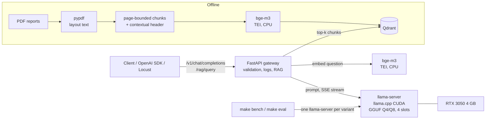

# Open-Weight LLM Deployment & Benchmarking Platform

[](https://github.com/salmabenchaouacha/llm-deploy-bench/actions/workflows/ci.yml)

Deploy quantized open-weight LLMs (Qwen 2.5, Llama 3.2, Mistral 7B — GGUF Q4_K_M / Q8_0,
llama.cpp, CUDA) on a **4 GB laptop GPU**, measure speed and memory, evaluate the quality of
a RAG pipeline on financial reports, and serve the best model behind an OpenAI-compatible
FastAPI gateway, load-tested with Locust.

Every number below comes from a raw file in [`results/`](results/) (CSV / JSONL), produced
by a `make` target. Nothing is copied by hand.

## Problem

Which open-weight model and quantization should a team deploy when the hardware is small
and the answers must be correct? Model cards report generic benchmarks on big GPUs. The
questions that decide a deployment are local: *does it fit in memory, how fast does it
answer, does quantization hurt the answers on our documents, and how many users can it
serve?* This project answers them end to end, on one RTX 3050 Laptop GPU (4 GB):

1. **Performance** — decode speed, time-to-first-token, VRAM, for each model × quantization.
2. **Quality** — a RAG pipeline over three company results reports, scored on 34
   hand-validated questions with deterministic metrics.
3. **Serving** — the best trade-off served through an OpenAI-compatible API, under load.

## Architecture



All services run with Docker Compose. Configuration is YAML validated by Pydantic
(`configs/`), every run appends rows to `results/**/summary.csv` with its git commit.

## Key results

Hardware: NVIDIA GeForce RTX 3050 Laptop GPU (4 GB), WSL2 + Docker Desktop.

**Speed and memory** ([`results/perf/report.md`](results/perf/report.md)) — greedy
decoding, 128 tokens, median of 9 runs:

| Model | Q4_K_M decode | Q8_0 decode | Q4 vs Q8 |
|---|--:|--:|--|
| Qwen 2.5 0.5B | 143.9 tok/s | — | |
| Qwen 2.5 1.5B | 93.1 tok/s | 70.7 tok/s | +32 % speed, −34 % VRAM (1,209 vs 1,839 MiB) |
| Llama 3.2 3B | 60.4 tok/s | 43.3 tok/s | +39 % speed; Q8 saturates the card |
| Mistral 7B | 13.5 tok/s (32 layers on GPU) | — | does not fit: offload sweep 0 → 32 layers = 2.0 → 13.5 tok/s |

**RAG quality** ([`results/eval/report.md`](results/eval/report.md)) — 34 hand-validated
questions (30 answerable, 4 unanswerable), same retriever for all (hit@5 93 %, MRR 0.73):

| Model | Quant | Answer accuracy | Hallucination | False refusal | Decode |
|---|---|--:|--:|--:|--:|
| **Llama 3.2 3B** | **Q4_K_M** | **93 %** | 0 % | 0 % | 60.4 tok/s |
| Llama 3.2 3B | Q8_0 | 90 % | 0 % | 0 % | 43.3 tok/s |
| Mistral 7B | Q4_K_M | 83 % | 0 % | 0 % | 13.5 tok/s |
| Qwen 2.5 1.5B | Q4_K_M | 57 % | 0 % | 30 % | 93.1 tok/s |
| Qwen 2.5 1.5B | Q8_0 | 50 % | 0 % | 40 % | 70.7 tok/s |
| Qwen 2.5 0.5B | Q4_K_M | 40 % | 75 % | 27 % | 143.9 tok/s |

**Serving under load** ([`results/load/report.md`](results/load/report.md)) — Llama 3.2 3B
Q4_K_M, 4 parallel slots, Locust closed loop, 60 s per level:

| Scenario | Users | Throughput | Latency p50 / p95 | TTFT p50 | Failures |
|---|--:|--:|--:|--:|--:|
| Chat (128 tokens) | 1 | 59.1 tok/s | 2.2 / 2.2 s | 66 ms | 0 |
| Chat | 5 | 130.1 tok/s | 4.0 / 7.6 s | 197 ms | 0 |
| Chat | 10 | 127.1 tok/s | 8.3 / 12.4 s | 4,397 ms | 0 |
| RAG | 1 | 0.33 req/s | 3.0 / 4.0 s | 2,339 ms | 0 |
| RAG | 5 | 0.51 req/s | 8.4 / 14.9 s | 3,318 ms | 0 |
| RAG | 10 | 0.53 req/s | 17.7 / 23.1 s | 12,104 ms | 0 |

**What the numbers say**

- **Llama 3.2 3B Q4_K_M is the deployment choice**: best accuracy, no hallucination on the
  unanswerable questions, ~1 s to first token in RAG, 60 tok/s.
- **Q4_K_M costs no measurable quality here** versus Q8_0 (93 vs 90 % for Llama, 57 vs 50 %
  for Qwen 1.5B: differences of 1–2 questions out of 30) while being 32–39 % faster
  (and 34 % lighter in VRAM for Qwen 1.5B).
- **Bigger is not better on a small GPU**: Mistral 7B is less accurate than Llama 3B and,
  partly in shared memory, takes ~16 s to the first token of a RAG answer.
- **Small models fail in opposite ways**: Qwen 1.5B refuses answerable questions
  (30–40 %), Qwen 0.5B invents answers to 3 of the 4 unanswerable ones.
- **Continuous batching doubles total throughput** (59 → 130 tok/s from 1 to 5 users);
  past the 4 slots, throughput plateaus and requests queue (TTFT 0.2 → 4.4 s).
- **RAG saturates at ~0.5 req/s**: each request carries a long prompt (5 retrieved
  chunks) to prefill before the first token, and the question embedding runs on CPU.

## Quickstart

Requirements: Python 3.11, [uv](https://docs.astral.sh/uv/), Git, Docker with NVIDIA GPU
support. On Windows, use WSL2 + Docker Desktop (Settings → Resources → WSL integration).

```bash
make install        # core + dev dependencies
make check          # lint + type-check + tests (what CI runs)
```

### Performance benchmark (Phase 1)

GGUF models run in the official `llama.cpp` server image (CUDA build), the same engine
used for serving. Weights are cached in `~/.cache/llmbench/models` (outside the repo).

```bash
make gpu-check      # the container must list the GPU
make download       # ~12 GB of GGUF files
make bench          # every enabled variant -> results/perf/summary.csv + runs.jsonl
make bench-sweep    # Mistral-7B: layers offloaded to GPU vs speed / VRAM
make report         # results/perf/report.md + figures, generated from the CSV
```

Protocol (`configs/bench.yaml`): 3 prompts (short, French, long RAG-like context),
1 warm-up + 3 repetitions each, greedy decoding, exactly 128 generated tokens
(`ignore_eos`), prompt cache disabled. Measured per variant: file size, load time,
time-to-first-token (client side), decode tokens/s, prefill tokens/s (server timings),
peak VRAM (NVML, device-level minus baseline) and peak container RAM. A variant that does
not fit is recorded with `error=cuda_oom`.

### RAG pipeline (Phase 2)

Corpus: three results press releases listed in `configs/rag.yaml` — Airbus FY2025,
TotalEnergies Q4/FY2025, Schneider Electric Q1 2025 (download each `url` into `data/raw/`;
PDFs are not versioned). Pipeline: pypdf (layout mode, keeps table columns) →
page-bounded chunks (~300 tokens, overlap) with a contextual header (`Company — Title`, so a
bare table row still says which company it belongs to) → `BAAI/bge-m3` embeddings served by
Text Embeddings Inference (CPU, keeps the GPU for the LLM) → Qdrant → top-k context → any
model/quantization served by llama.cpp. The retriever is fixed, so every model receives the
same context.

```bash
make rag-up                     # Qdrant + embedding server (Docker)
make ingest                     # PDFs -> chunks -> embeddings -> Qdrant -> results/rag/ingest.json
make ask Q="How many commercial aircraft did Airbus deliver in 2025?"
make ask Q="Quel est le résultat net ajusté de TotalEnergies en 2025 ?" MODEL=llama3.2-3b
uv run python -m llmbench.rag.ask "..." --retrieval-only   # inspect retrieved chunks only
```

### Quality evaluation (Phase 3)

Evaluation set `data/eval/questions.jsonl`: questions drafted from the corpus, then each one
reviewed by hand (`make eval-validate`: validate / edit / reject, source page shown). Only
validated items are scored. Metrics are deterministic (no LLM judge, reproducible, free):

| Metric | Meaning |
|---|---|
| retrieval hit@k, MRR | a chunk from the source page is among the top-k retrieved |
| answer accuracy | every key fact (exact figure, normalised: `15,587` = `15587`, `15,6` = `15.6`) is in the answer |
| fact recall | share of key facts found |
| hallucination rate | unanswerable questions answered anyway |
| false refusal rate | answerable questions the model refused |

```bash
make eval-validate   # human review of the drafted questions
make eval-smoke      # 3 questions, 1 model: checks the whole chain
make eval            # every variant of configs/eval.yaml -> results/eval/summary.csv + answers/
make eval-report     # results/eval/report.md: accuracy table + quality-vs-speed figure
```

### Serving API and load test (Phase 4)

One model served permanently (default: Llama 3.2 3B Q4_K_M, the best quality/speed
trade-off of Phase 3) by llama-server with continuous batching (4 parallel slots), behind a
FastAPI gateway that speaks the OpenAI API:

| Endpoint | |
|---|---|
| `POST /v1/chat/completions` | OpenAI-compatible, `stream: true` relays Server-Sent Events token by token |
| `GET /v1/models` | served model |
| `POST /rag/query` | `{"question": "..."}` -> answer + sources (doc, page, score) + timings |
| `GET /health` | 200 only when llm, embedder and qdrant all answer |
| `GET /docs` | interactive OpenAPI documentation |

```bash
make serve-up        # builds the API image, starts llm + api + qdrant + embedder
curl -s localhost:8000/health
curl -s localhost:8000/rag/query -H 'Content-Type: application/json' \
     -d '{"question": "How many commercial aircraft did Airbus deliver in 2025?"}'
make load            # Locust, chat endpoint, 1 / 5 / 10 concurrent users -> results/load/
make load-rag        # same on the full RAG pipeline
make load-report     # results/load/report.md: throughput and latency vs users
make serve-down
```

Any OpenAI client works: `OpenAI(base_url="http://localhost:8000/v1", api_key="unused")`.

## Project layout

| Path | Content |
|---|---|
| `src/llmbench/` | Installable package: `models`, `rag`, `eval`, `serving`, `api`, `load`, `monitoring` |
| `load/` | Locust scenarios (`locustfile.py`) |
| `docker/` | API image (`api.Dockerfile`) |
| `configs/` | YAML configuration, validated by Pydantic (`src/llmbench/config.py`) |
| `data/` | Raw / processed corpus (git-ignored) and the hand-validated eval set (`data/eval/`) |
| `results/` | Raw measurements (CSV/JSON), versioned |
| `tests/` | Pytest suite |

## Technical choices

| Choice | Why | Alternative considered |
|---|---|---|
| GGUF + llama.cpp server (Docker, CUDA) | Runs 0.5B–7B models on 4 GB with partial GPU offload; same engine for benchmark and serving; no Python binding to compile | vLLM / TGI: need more VRAM, no CPU offload |
| Q4_K_M and Q8_0 | The two most used GGUF levels: 4-bit k-quant vs near-lossless 8-bit | fp16, bitsandbytes, AWQ: do not fit in 4 GB (V2 on a larger GPU) |
| Benchmark through the HTTP API, `ignore_eos`, prompt cache off | Measures what a user gets, fixed output length, no cache-hit TTFT | Python bindings: different code path than production |
| bge-m3 embeddings on TEI (CPU) | Multilingual (French questions on English reports), leaves the GPU to the LLM | GPU embeddings: compete for 4 GB of VRAM |
| Qdrant | Production vector DB, REST API, payload filters, persistent volume | FAISS / Chroma: in-process, less representative of a deployment |
| Contextual chunk header (`Company — Title`) | A table row rarely names the company; the header raised the top retrieval score on company questions | Bigger chunks: less precise |
| Deterministic metrics (exact figures, refusals) | Reproducible, free, auditable line by line in `results/eval/answers/` | LLM-as-judge (RAGAS): costs, varies between runs |
| Retrieval computed once for all models | Every model gets exactly the same chunks: differences come from the model | Retrieve per model: noise from the retriever |
| FastAPI gateway in front of llama-server | Validation before the GPU, logs with latency, RAG logic, one place for auth / rate limits; inference engine replaceable | Expose llama-server directly |
| Locust closed loop + client-side records | N users = N requests in flight; exact TTFT and latency per request in `results/load/raw/` | Locust built-in stats: stop at stream headers |

## Limitations & next steps

- **Small evaluation set**: 34 questions, only 4 unanswerable — the hallucination rate is a
  signal (3/4), not a statistic. Next: more unanswerable and multi-hop questions.
- **One machine, one GPU**: VRAM figures are device-level (desktop included); once the card
  is full the Windows driver spills to shared memory, so saturated values are lower bounds.
  The load test shares 10 GB of RAM between the LLM, the embedder, Qdrant and Locust.
- **Single model served**: no autoscaling, auth or rate limiting yet.
- **V2**: fp16 / bitsandbytes / AWQ on a larger GPU (Kaggle), lm-evaluation-harness,
  QLoRA fine-tuning, Prometheus + Grafana on the llama-server `/metrics` endpoint.
