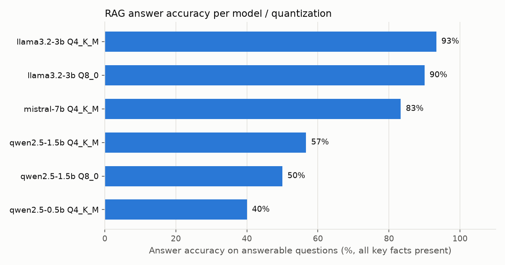
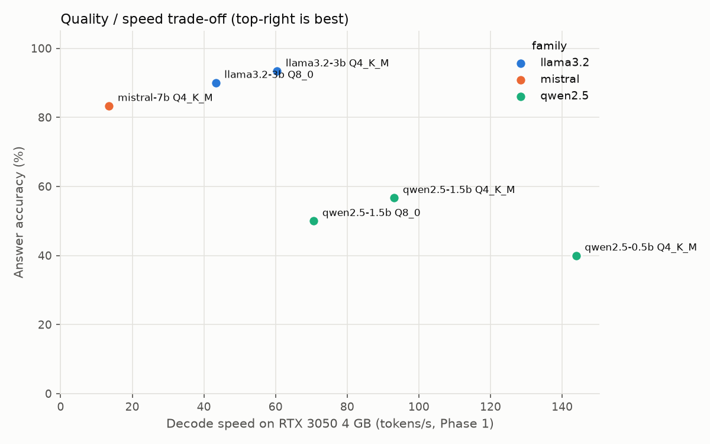

# RAG quality evaluation — results

_Generated by `python -m llmbench.eval.report` from [`summary.csv`](summary.csv); per-question answers in [`answers/`](answers/)._

Evaluation set: **34 hand-validated questions** (30 answerable, 4 unanswerable), dataset `3332d7e117c1`. Same retriever for every model: retrieval hit@k **93%**, MRR **0.73**. Greedy decoding.

| Model | Quant | Answer accuracy | Fact recall | Hallucination¹ | False refusal² | RAG TTFT p50 (ms) | Decode (tok/s) |
|---|---|--:|--:|--:|--:|--:|--:|
| llama3.2-3b | Q4_K_M | **93%** | 94% | 0% | 0% | 1,121 | 60.4 |
| llama3.2-3b | Q8_0 | **90%** | 90% | 0% | 0% | 1,018 | 43.3 |
| mistral-7b | Q4_K_M | **83%** | 84% | 0% | 0% | 16,118 | 13.5 |
| qwen2.5-1.5b | Q4_K_M | **57%** | 58% | 0% | 30% | 642 | 93.1 |
| qwen2.5-1.5b | Q8_0 | **50%** | 52% | 0% | 40% | 540 | 70.7 |
| qwen2.5-0.5b | Q4_K_M | **40%** | 42% | 75% | 27% | 274 | 143.9 |

¹ Unanswerable questions answered anyway (invented). ² Answerable questions the model refused.

