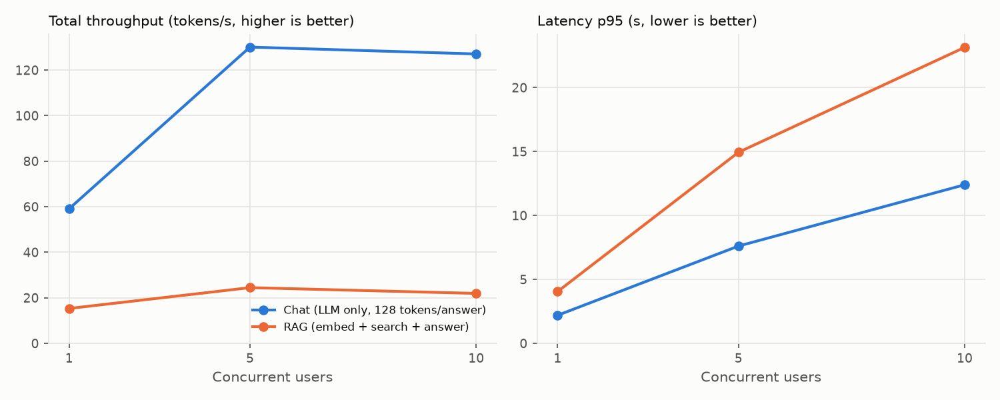

# Load test — results

_Generated by `python -m llmbench.load.report` from [`summary.csv`](summary.csv); per-request records in [`raw/`](raw/)._

Setup: model **llama3.2-3b-q4_k_m** served by llama-server with **4 parallel slots**, behind the FastAPI gateway; GPU NVIDIA GeForce RTX 3050 Laptop GPU. Locust, closed loop (each user sends its next request as soon as the previous one ends), 60 s per level. Throughput = generated tokens of successful requests / wall-clock time. VRAM = whole device (includes the desktop).

| Scenario | Users | Requests ok / failed | Req/s | Throughput (tok/s) | Latency p50 / p95 (s) | TTFT p50 / p95 (ms) | Decode per request (tok/s) | VRAM peak (MiB) |
|---|--:|--:|--:|--:|--:|--:|--:|--:|
| chat | 1 | 28 / 0 | 0.46 | **59.1** | 2.2 / 2.2 | 66 / 98 | 60.7 | 3,562 |
| chat | 5 | 65 / 0 | 1.02 | **130.1** | 4.0 / 7.6 | 197 / 3,831 | 33.9 | 3,564 |
| chat | 10 | 66 / 0 | 0.99 | **127.1** | 8.3 / 12.4 | 4,397 / 8,468 | 33.0 | 3,564 |
| rag | 1 | 20 / 0 | 0.33 | **15.3** | 3.0 / 4.0 | 2,339 / 2,964 | 53.4 | 3,562 |
| rag | 5 | 33 / 0 | 0.51 | **24.5** | 8.4 / 14.9 | 3,318 / 6,222 | 7.8 | 3,564 |
| rag | 10 | 39 / 0 | 0.53 | **21.9** | 17.7 / 23.1 | 12,104 / 14,986 | 7.1 | 3,564 |

