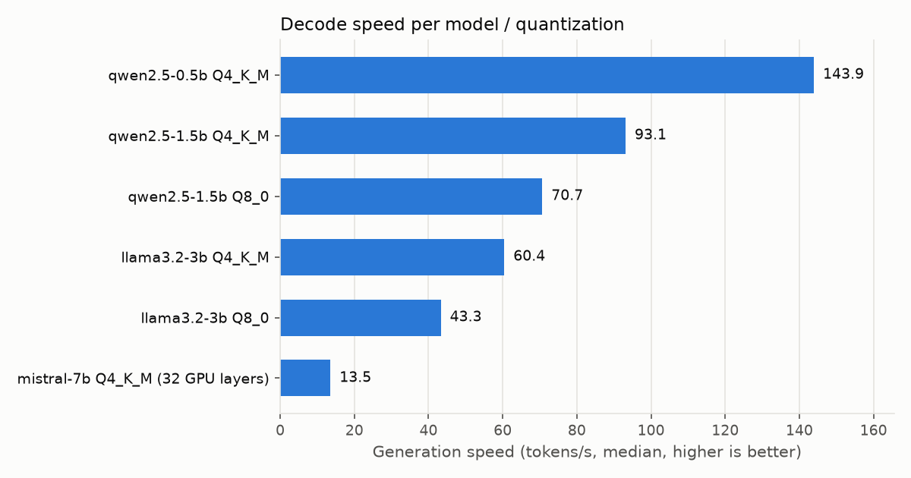
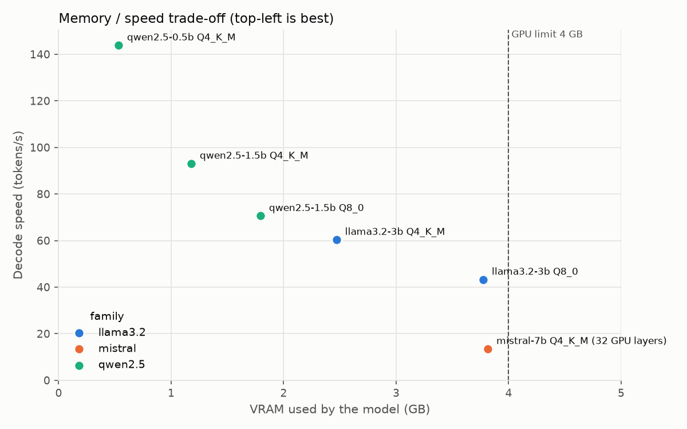
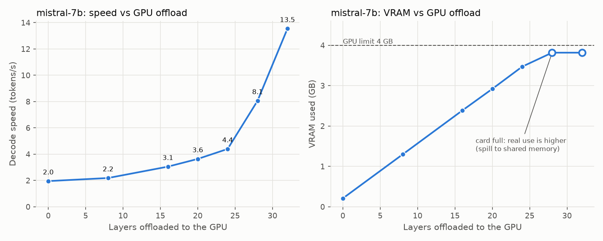

# Performance benchmark — results

_Generated by `python -m llmbench.models.report` from [`summary.csv`](summary.csv). Do not edit by hand._

Protocol: `configs/bench.yaml` — greedy decoding, 128 generated tokens per run, prompt cache disabled, 1 warm-up + 3 repetitions of 3 prompts. VRAM = device memory used minus the baseline before loading.

## Comparison

| Model | Quant | GPU layers | File (GB) | VRAM (MiB) | TTFT short p50 (ms) | TTFT long p50 (ms) | Prefill (tok/s) | Decode (tok/s) |
|---|---|---|--:|--:|--:|--:|--:|--:|
| qwen2.5-0.5b | Q4_K_M | all | 0.46 | 547 | 43 | 52 | 3,841 | **143.9** ± 3.2 |
| qwen2.5-1.5b | Q4_K_M | all | 1.04 | 1,209 | 60 | 93 | 2,538 | **93.1** ± 0.5 |
| qwen2.5-1.5b | Q8_0 | all | 1.76 | 1,839 | 92 | 95 | 2,364 | **70.7** ± 1.0 |
| llama3.2-3b | Q4_K_M | all | 1.88 | 2,531 | 126 | 206 | 1,746 | **60.4** ± 0.4 |
| llama3.2-3b | Q8_0 | all | 3.19 | ≥ 3,867 ¹ | 157 | 232 | 1,660 | **43.3** ± 0.2 |
| mistral-7b | Q4_K_M | 32 | 4.07 | ≥ 3,909 ¹ | 307 | 1,968 | 173 | **13.5** ± 0.5 |

¹ VRAM saturated: NVML only reports physical GPU memory. Once the card is full, the Windows NVIDIA driver can spill allocations to shared system memory (sysmem fallback) instead of failing with out-of-memory, so these VRAM values are a lower bound and part of the model is read over PCIe.

## GPU offload sweep — mistral-7b

| GPU layers | VRAM (MiB) | TTFT long p50 (ms) | Decode (tok/s) | Status |
|--:|--:|--:|--:|---|
| 0 | 215 | 1,823 | 2.0 | ok |
| 8 | 1,329 | 1,512 | 2.2 | ok |
| 16 | 2,445 | 1,114 | 3.1 | ok |
| 20 | 2,991 | 1,121 | 3.6 | ok |
| 24 | 3,555 | 1,042 | 4.4 | ok |
| 28 | ≥ 3,909 ¹ | 2,272 | 8.1 | ok |
| 32 | ≥ 3,909 ¹ | 1,968 | 13.5 | ok |

¹ VRAM saturated: NVML only reports physical GPU memory. Once the card is full, the Windows NVIDIA driver can spill allocations to shared system memory (sysmem fallback) instead of failing with out-of-memory, so these VRAM values are a lower bound and part of the model is read over PCIe.

